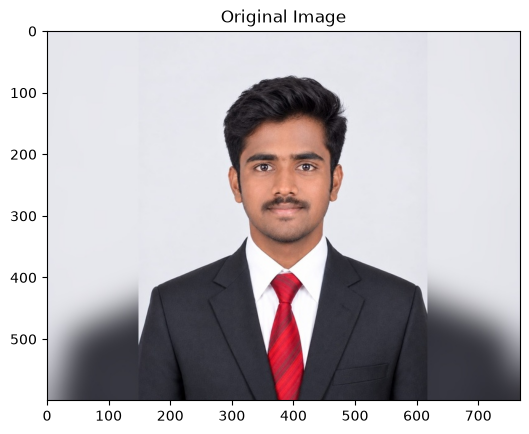
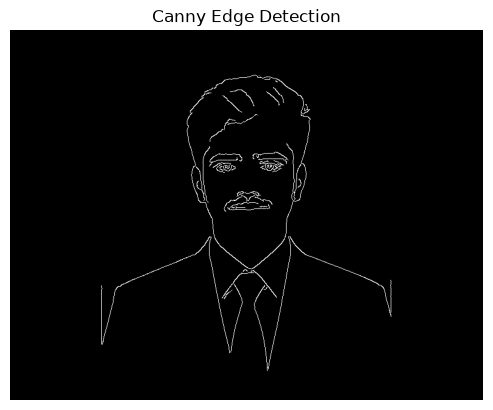
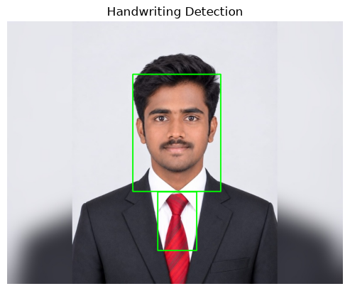
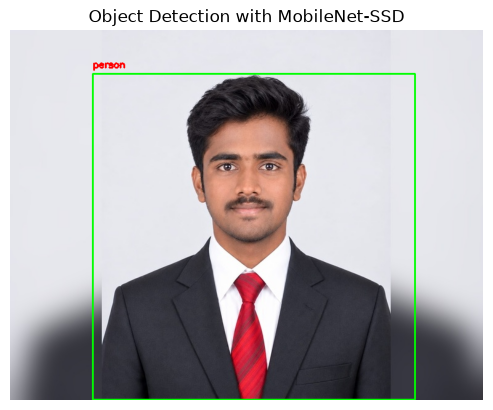

# Experiment 12 – Image Processing Projects

## Name : MUTHUAKASH M

## Register Number : 212225230194

## Aim

To implement ROI segmentation using Bitwise AND, handwriting detection using image processing techniques, and object detection with labels using the MobileNet-SSD pretrained model.

## Software Requirements

- Python
- Jupyter Notebook
- OpenCV
- NumPy
- Matplotlib

---

# I) ROI Segmentation in an Image using Bitwise AND

## Algorithm

1. Import the required libraries OpenCV, NumPy, and Matplotlib.
2. Read the input image using `cv2.imread()`.
3. Convert the image from BGR to RGB for display.
4. Define the Region of Interest (ROI) using image coordinates.
5. Create a blank mask using `np.zeros_like()`.
6. Place the selected ROI on the mask.
7. Apply Bitwise AND using `cv2.bitwise_and()`.
8. Display the segmented ROI image.

## Program 1: Import Libraries

```python
import cv2
import numpy as np
import matplotlib.pyplot as plt
```

## Program 2: Read and Convert the Image

```python
image = cv2.imread('Qno. 1.jpg')
image_rgb = cv2.cvtColor(image, cv2.COLOR_BGR2RGB)
```

## Program 3: Display the Original Image

```python
plt.imshow(image_rgb)
plt.title("Original Image")
plt.axis('on')
plt.show()
```





## Program 4: Define ROI and Create Mask

```python
roi = image[100:420, 200:550]

mask = np.zeros_like(image)

mask[100:420, 200:550] = roi
```

## Program 5: Apply Bitwise AND

```python
segmented_roi = cv2.bitwise_and(image, mask)
```

## Program 6: Display the Segmented ROI

```python
segmented_roi_rgb = cv2.cvtColor(segmented_roi, cv2.COLOR_BGR2RGB)

plt.imshow(segmented_roi_rgb)
plt.title("Segmented ROI")
plt.axis('off')
plt.show()
```

## Output


---

# II) Handwriting Detection in an Image

## Algorithm

1. Import the required libraries.
2. Read the input image and convert it into RGB.
3. Convert the image into grayscale.
4. Apply Gaussian Blur to reduce noise.
5. Apply Canny Edge Detection to detect edges.
6. Find contours in the edge-detected image.
7. Filter contours based on area.
8. Draw bounding boxes around the detected handwriting regions.
9. Display the handwriting detection result.

## Program 1: Import Libraries

```python
import cv2
import numpy as np
import matplotlib.pyplot as plt
```

## Program 2: Read and Convert the Image

```python
image = cv2.imread('Qno. 1.jpg')
image_rgb = cv2.cvtColor(image, cv2.COLOR_BGR2RGB)
```

## Program 3: Display the Original Image

```python
plt.imshow(image_rgb)
plt.title("Original Image")
plt.axis('off')
```


## Program 4: Convert to Grayscale

```python
gray_image = cv2.cvtColor(image, cv2.COLOR_BGR2GRAY)
```

## Program 5: Apply Gaussian Blur

```python
blurred_image = cv2.GaussianBlur(gray_image, (5, 5), 0)
```

## Program 6: Detect Edges using Canny

```python
edges = cv2.Canny(blurred_image, 50, 150)

plt.imshow(edges, cmap='gray')
plt.title("Canny Edge Detection")
plt.axis('off')
```




## Program 7: Find Contours

```python
contours, _ = cv2.findContours(
    edges, cv2.RETR_EXTERNAL, cv2.CHAIN_APPROX_SIMPLE
)
```

## Program 8: Draw Bounding Boxes

```python
result_image = image.copy()

for contour in contours:
    if cv2.contourArea(contour) > 50:
        x, y, w, h = cv2.boundingRect(contour)
        cv2.rectangle(result_image, (x, y), (x + w, y + h), (0, 255, 0), 2)
```

## Program 9: Display Handwriting Detection Result

```python
plt.imshow(cv2.cvtColor(result_image, cv2.COLOR_BGR2RGB))
plt.title("Handwriting Detection")
plt.axis('off')
```

## Output



---

# III) Object Detection with Labels in an Image using MobileNet-SSD

## Algorithm

1. Import the required libraries.
2. Download and load the MobileNet-SSD configuration and weights files.
3. Load the pretrained model using `cv2.dnn.readNetFromCaffe()`.
4. Define the class labels.
5. Read the input image and get its height and width.
6. Convert the image into a blob using `cv2.dnn.blobFromImage()`.
7. Pass the blob to the network and perform forward propagation.
8. Check the confidence score of each detection.
9. Draw bounding boxes and labels for objects with confidence greater than 0.5.
10. Display the object detection result.

## Required Model Files

Download the MobileNet-SSD model files from:

https://github.com/chuanqi305/MobileNet-SSD

Required files:

- `deploy.prototxt`
- `mobilenet_iter_73000.caffemodel`

Place both files in the same folder as the notebook.

## Program 1: Import Libraries

```python
import cv2
import numpy as np
import matplotlib.pyplot as plt
```

## Program 2: Set Model Files

```python
config_file = 'deploy.prototxt'
weights = 'mobilenet_iter_73000.caffemodel'
```

## Program 3: Load the Pretrained Model

```python
net = cv2.dnn.readNetFromCaffe(config_file, weights)
```

## Program 4: Define Class Labels

```python
class_labels = {
    0: 'background', 1: 'aeroplane', 2: 'bicycle', 3: 'bird',
    4: 'boat', 5: 'bottle', 6: 'bus', 7: 'car', 8: 'cat',
    9: 'chair', 10: 'cow', 11: 'diningtable', 12: 'dog',
    13: 'horse', 14: 'motorbike', 15: 'person', 16: 'pottedplant',
    17: 'sheep', 18: 'sofa', 19: 'train', 20: 'tvmonitor'
}
```

## Program 5: Read the Input Image

```python
image = cv2.imread("Qno. 1.jpg")
(h, w) = image.shape[:2]

image_rgb = cv2.cvtColor(image, cv2.COLOR_BGR2RGB)
```

## Program 6: Create Blob

```python
blob = cv2.dnn.blobFromImage(
    image, 0.007843, (300, 300), 127.5
)
```

## Program 7: Perform Object Detection

```python
net.setInput(blob)
detections = net.forward()
```

## Program 8: Draw Bounding Boxes and Labels

```python
for i in range(detections.shape[2]):
    confidence = detections[0, 0, i, 2]

    if confidence > 0.5:
        index = int(detections[0, 0, i, 1])
        label = class_labels[index]

        box = detections[0, 0, i, 3:7] * np.array([w, h, w, h])
        (startX, startY, endX, endY) = box.astype("int")

        cv2.rectangle(image_rgb, (startX, startY), (endX, endY), (0, 255, 0), 2)

        cv2.putText(
            image_rgb, label, (startX, startY - 10),
            cv2.FONT_HERSHEY_SIMPLEX, 0.5, (255, 0, 0), 2
        )
```

## Program 9: Display Object Detection Result

```python
plt.imshow(image_rgb)
plt.title("Object Detection with MobileNet-SSD")
plt.axis("off")
plt.show()
```

## Output


---

## Result

Thus, ROI segmentation using Bitwise AND, handwriting detection using Gaussian Blur, Canny edge detection and contours, and object detection using the MobileNet-SSD pretrained model were implemented successfully using Python and OpenCV.